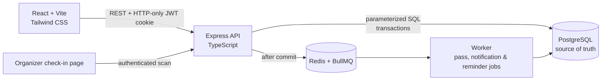
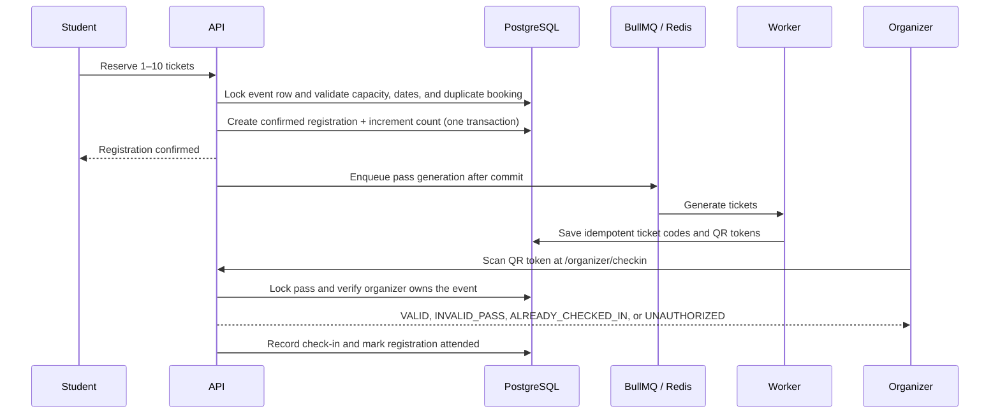

# Festo — College Event Ticketing & Gate Validation System

Festo is an end-to-end college event ticketing and validation platform. It enables students to discover campus events, reserve capacity-controlled tickets, receive unique QR passes, and enter venues through secure organizer-operated gate validation.

Its core promise is simple: every confirmed reservation becomes a traceable digital pass, and every pass is validated once against the correct event at the gate. Festo combines transactional booking, background QR-ticket generation, a digital ticket wallet, and real-time check-in records so colleges can run events without overselling seats or accepting duplicate passes.

## Architecture



The backend is a modular monolith: routes → controllers → services → repositories. PostgreSQL is authoritative; Redis and workers perform asynchronous work and never decide whether a registration exists.

## Ticket reservation, pass generation, and validation



### Reservation guarantees

- Capacity is protected with a PostgreSQL transaction and row lock, preventing overselling.
- A registration is committed before a job is queued; a Redis outage does not undo a valid reservation.
- Ticket creation is idempotent, so retries and duplicate jobs do not create duplicate passes.
- The ticket wallet can reconcile outstanding tickets if a worker was unavailable.
- QR validation locks the pass/check-in path, preventing a ticket being accepted twice.
- The scanner endpoint requires an authenticated `ORGANIZER` and verifies that the scanner created the event.

## Features

- Public event and college discovery, search, categories, saved events, and event details.
- Authentication, password reset, HTTP-only JWT session cookies, role protection, and rate limiting.
- Event hosting, media uploads, capacity management, registrations, tickets, and attendee dashboards.
- Organizer QR scanner at `/organizer/checkin`.
- BullMQ jobs for pass generation, notifications, and event reminders.
- PostgreSQL migrations through `node-pg-migrate`.

## Stack

| Area | Technology |
| --- | --- |
| Frontend | React 18, Vite 6, TypeScript, React Router, TanStack Query, Tailwind CSS 4 |
| API | Node.js, Express, TypeScript, Zod, REST |
| Data | PostgreSQL 16, `pg`, parameterized SQL |
| Jobs | Redis 7, BullMQ |
| Security | Argon2 password hashes, JWT HTTP-only cookies, CORS, rate limits, validation |
| Media and email | Cloudinary and Resend |
| Local runtime | Docker Compose |

## Repository layout

```text
festo-frontend/              React/Vite application
  src/pages/                  Public, auth, student, college, and admin screens
  src/components/             UI, event, pass, check-in, and common components
  src/services/               Typed API clients

festo-backend/               Express API and background workers
  src/modules/                Feature modules: routes, controllers, services, repos, schemas
  src/workers/                BullMQ queues and processors
  src/db/                     PostgreSQL pool and transaction helper
  migrations/                 Database migration history (CommonJS for node-pg-migrate)

docker-compose.yml            Local frontend, API, worker, PostgreSQL, and Redis
```

Compiled backend files in `festo-backend/build/` are generated JavaScript by design. Database migration files remain `.cjs` because `node-pg-migrate` loads them at runtime.

## Run locally

### Full stack with Docker

1. Create local environment files from the supplied examples where applicable. Never commit them.
2. Set a strong `JWT_SECRET` outside the repository for any non-local deployment.
3. From the repository root:

```bash
docker compose up --build
```

| Service | Address |
| --- | --- |
| Frontend | http://localhost:5173 |
| API | http://localhost:5002 |
| API health | http://localhost:5002/health |
| QR scanner | http://localhost:5173/organizer/checkin |
| PostgreSQL | `localhost:5432` |
| Redis | `localhost:6379` |

Stop the stack with `docker compose down`.

### Run frontend and backend separately

```bash
# terminal 1
cd festo-backend && npm install && npm run dev:api

# terminal 2
cd festo-backend && npm run dev:worker

# terminal 3
cd festo-frontend && npm install && npm run dev
```

Run migrations with `cd festo-backend && npm run migrate:up`.

## Quality checks

```bash
cd festo-frontend && npm run typecheck && npm run build
cd ../festo-backend && npm run typecheck && npm run build
```

Both applications are migrated to TypeScript. Configuration and migration files stay JavaScript/CommonJS only where their toolchain requires it.

## Security notes

- `.env`, cookie captures, logs, PID files, generated builds, and dependencies are ignored by Git.
- Do not use the development Docker Compose JWT fallback outside local development.
- Use HTTPS and secure production cookie settings when deploying.
- Keep PostgreSQL and Redis unavailable from the public internet unless protected by your infrastructure.
